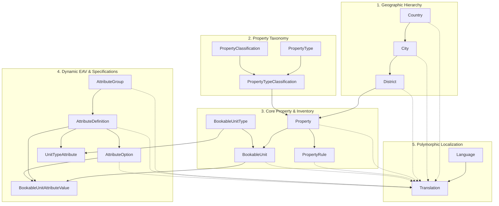
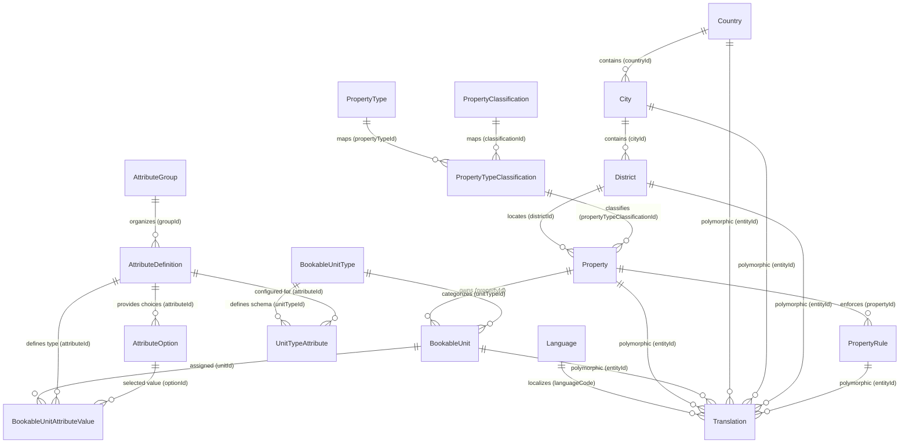
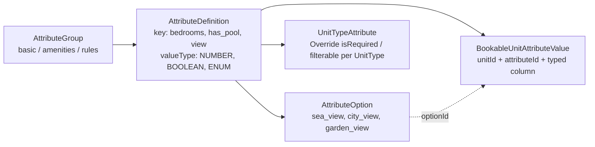

# Property Engine Database Relational Analysis Report

> **Source File**: [property_engine.xlsx](file:///c:/Users/adhm1/OneDrive/Desktop/dashboard/property_engine.xlsx)  
> **Schema Scope**: 17 Sheets / Simulated Database Tables  
> **Integrity Verification**: 100% Referential Integrity Verified (0 FK Violations across sample data)  
> **Primary Key Architecture**: UUIDv7 (Timestamp-ordered, 128-bit globally unique identifiers)

---

## 1. Executive Summary

The **Property Engine** workbook represents a enterprise-grade, highly normalized relational database schema designed for a multi-tenant hospitality, vacation rental, and property booking platform (similar to Airbnb, Booking.com, or Gathern).

The architecture is divided into **five distinct, decoupled functional subsystems**:
1. **Geographic Hierarchy Subsystem** (`Country` → `City` → `District`)
2. **Property Classification & Taxonomy Subsystem** (`PropertyType`, `PropertyClassification`, `PropertyTypeClassification`)
3. **Core Property & Inventory Subsystem** (`Property`, `PropertyRule`, `BookableUnitType`, `BookableUnit`)
4. **Dynamic EAV Specification Engine** (`AttributeGroup`, `AttributeDefinition`, `AttributeOption`, `UnitTypeAttribute`, `BookableUnitAttributeValue`)
5. **Polymorphic Localization & i18n Subsystem** (`Language`, `Translation`)

---

## 2. Complete Entity-Relationship (ER) Diagram

---

## 3. Deep-Dive into the 5 Subsystems

### Subsystem 1: Geographic Hierarchy

This subsystem models administrative boundaries down to the district/neighborhood level:

| Table | Primary Key | Foreign Keys | Business Purpose & Key Constraints |
| :--- | :--- | :--- | :--- |
| **`Country`** | `id` (UUIDv7) | *None* | Top-level geographic entity. `slug` (unique lookup slug, e.g. `sa`), `code` (ISO-2 e.g. `SA`), `key` (phone dial code e.g. `+966`), and fallback `name`. |
| **`City`** | `id` (UUIDv7) | `countryId` → `Country.id` | Regional division. Compound unique constraint on `(countryId, slug)`. Fallback `name`. |
| **`District`** | `id` (UUIDv7) | `cityId` → `City.id` | Granular neighborhood/borough. Compound unique constraint on `(cityId, slug)`. Fallback `name`. |

> [!NOTE]
> All geographic tables follow the **fallback name + translation table** pattern: the base table holds the default fallback name, while localized variants (Arabic, English, etc.) are fetched from the `Translation` table.

---

### Subsystem 2: Classification & Taxonomy

Decouples the structural kind of property from its commercial/quality tier:

| Table | Primary Key | Foreign Keys | Business Purpose & Key Constraints |
| :--- | :--- | :--- | :--- |
| **`PropertyType`** | `id` (UUIDv7) | *None* | Identifies architectural / venue form: `hotel`, `apartment`, `chalet`, `hall`. Unique `code`. |
| **`PropertyClassification`** | `id` (UUIDv7) | *None* | Quality / service tier: `standard`, `premium`, `luxury`, `family`. Unique `code`. |
| **`PropertyTypeClassification`** | `id` (UUIDv7) | `propertyTypeId` → `PropertyType.id` `classificationId` → `PropertyClassification.id` | Bridge / allowable combinations table. Prevents illegal pairings and allows enabling/disabling specific tiers per property type. |

---

### Subsystem 3: Core Property & Inventory

Distinguishes between the **physical real-estate complex (`Property`)** and the **rentable inventory units (`BookableUnit`)**:

| Table | Primary Key | Foreign Keys | Business Purpose & Key Constraints |
| :--- | :--- | :--- | :--- |
| **`Property`** | `id` (UUIDv7) | `ownerId` → `User.id` `propertyTypeClassificationId` → `PropertyTypeClassification.id` `districtId` → `District.id` | Physical facility entity. Contains status (`PENDING`, `ACTIVE`, `MAINTENANCE`, `REJECTED`, `INACTIVE`), detailed street address, landmark, and GPS coordinates (`latitude`, `longitude`). |
| **`PropertyRule`** | `id` (UUIDv7) | `propertyId` → `Property.id` | Property policies: check-in, check-out, refund, security deposit, smoking. Typed values (`TEXT`, `BOOLEAN`, `TIME`, `MONEY`) with custom sort ordering and icons. Unique `(propertyId, code)`. |
| **`BookableUnitType`** | `id` (UUIDv7) | *None* | Classifies the unit form: `single_room`, `double_room`, `suite`, `apartment_unit`, `chalet_unit`, `hall_section`. |
| **`BookableUnit`** | `id` (UUIDv7) | `propertyId` → `Property.id` `unitTypeId` → `BookableUnitType.id` | Individual rentable inventory. Stores `capacity`, `basePrice`, `offerPrice`, status, and a **`filterAttributes` JSON** column for high-speed indexing. |

> [!TIP]
> **One-to-Many Architecture**: One `Property` can have multiple `BookableUnit`s. For example, a Hotel property owns multiple suites and double rooms. A private Chalet property owns one entire chalet unit.

---

### Subsystem 4: Dynamic EAV (Entity-Attribute-Value) Specification Engine

A dynamic attribute management system allowing arbitrary property features and amenities without database schema migrations:

1. **`AttributeGroup`**: Groups attributes in the UI (e.g. `basic`, `amenities`, `rules`, `pricing`).
2. **`AttributeDefinition`**: Defines attribute keys, metadata, display flags (`isRequired`, `isFilterable`, `isSearchable`, `isDisplayable`), and strong value typing:
   - `TEXT`, `NUMBER`, `BOOLEAN`, `ENUM`, `DATE`, `JSON`.
3. **`AttributeOption`**: Stores fixed enumerated choices when `valueType = 'ENUM'` (e.g., `sea_view`, `city_view`).
4. **`UnitTypeAttribute`**: Schema enforcement bridge: configures which attributes are required or filterable for each unit type (e.g., a `chalet_unit` may require `has_pool`, while a `single_room` does not).
5. **`BookableUnitAttributeValue`**: Strongly-typed EAV storage:
   - Uses dedicated columns (`valueString`, `valueNumber`, `valueBoolean`, `valueDate`, `valueJson`, `optionId`) instead of storing everything as plain text, preserving indexing and numeric sorting.

---

### Subsystem 5: Polymorphic Localization & Internationalization (i18n)

A centralized localization system supporting Right-to-Left (RTL) and Left-to-Right (LTR) languages:

| Table | Primary Key | Foreign Keys | Business Purpose |
| :--- | :--- | :--- | :--- |
| **`Language`** | `id` (UUIDv7) | *None* | Supported languages (e.g. `ar` - Arabic [RTL, default], `en` - English [LTR]). |
| **`Translation`** | `id` (UUIDv7) | `languageCode` → `Language.code` | Polymorphic translation store. Translates any field of any entity. |

#### Polymorphic Translation Mapping
In `Translation`:
- `entityType`: ENUM (`COUNTRY`, `CITY`, `DISTRICT`, `PROPERTY`, `BOOKABLE_UNIT`, `PROPERTY_RULE`, `ATTRIBUTE_GROUP`, `ATTRIBUTE_DEFINITION`, `ATTRIBUTE_OPTION`, `UI_LABEL`, `HOME_SECTION`, etc.).
- `entityId`: Foreign key pointing to the target table's primary key (`UUIDv7`).
- `field`: The localized attribute name (`name`, `description`, `rule_text`, etc.).
- `languageCode`: Language code reference (`ar`, `en`).
- `value`: Localized text.

---

## 4. Sheet-by-Sheet Relational Schema Specification

### 1. `Country` (3 records in simulation)
- **`id`** (`UUIDv7`, PK): Primary Key. Referenced by `City.countryId`, `Translation.entityId`.
- **`slug`** (`VarChar`, UNIQUE): Canonical URL slug (`sa`, `ae`, `ye`).
- **`code`** (`VarChar(10)`, UNIQUE): ISO 3166-1 alpha-2 code (`SA`, `AE`, `YE`).
- **`key`** (`VarChar(80)`, UNIQUE): Phone dial code (`+966`, `+971`, `+967`).
- **`name`** (`VarChar(120)`, REQUIRED): Fallback name.

### 2. `City` (4 records in simulation)
- **`id`** (`UUIDv7`, PK): Primary Key. Referenced by `District.cityId`, `Translation.entityId`.
- **`countryId`** (`UUIDv7`, FK): References `Country.id`.
- **`slug`** (`VarChar`, UNIQUE with `countryId`): URL slug (`riyadh`, `jeddah`, `dubai`, `sanaa`).
- **`name`** (`VarChar(120)`, REQUIRED): Fallback city name.

### 3. `District` (4 records in simulation)
- **`id`** (`UUIDv7`, PK): Primary Key. Referenced by `Property.districtId`, `Translation.entityId`.
- **`cityId`** (`UUIDv7`, FK): References `City.id`.
- **`slug`** (`VarChar`, UNIQUE with `cityId`): District slug (`al-olaya`, `al-malqa`, `downtown-dubai`, `hadda`).
- **`name`** (`VarChar(120)`, REQUIRED): Fallback district name.

### 4. `PropertyType` (4 records in simulation)
- **`id`** (`UUIDv7`, PK): Referenced by `PropertyTypeClassification.propertyTypeId`.
- **`code`** (`VarChar(50)`, UNIQUE): `hotel`, `apartment`, `chalet`, `hall`.
- **`isActive`** (`BOOLEAN`): Activation flag.

### 5. `PropertyClassification` (4 records in simulation)
- **`id`** (`UUIDv7`, PK): Referenced by `PropertyTypeClassification.classificationId`.
- **`code`** (`VarChar(50)`, UNIQUE): `standard`, `premium`, `luxury`, `family`.
- **`isActive`** (`BOOLEAN`): Activation flag.

### 6. `PropertyTypeClassification` (3 records in simulation)
- **`id`** (`UUIDv7`, PK): Referenced by `Property.propertyTypeClassificationId`.
- **`propertyTypeId`** (`UUIDv7`, FK): References `PropertyType.id`.
- **`classificationId`** (`UUIDv7`, FK): References `PropertyClassification.id`.
- **`isActive`** (`BOOLEAN`): Flag indicating whether this pairing is enabled.

### 7. `Property` (2 records in simulation)
- **`id`** (`UUIDv7`, PK): Referenced by `BookableUnit.propertyId`, `PropertyRule.propertyId`, `Translation.entityId`.
- **`ownerId`** (`UUIDv7`, FK): References external `User.id` (property host/owner).
- **`propertyTypeClassificationId`** (`UUIDv7`, FK): References `PropertyTypeClassification.id`.
- **`districtId`** (`UUIDv7`, FK): References `District.id`.
- **`name`** (`VarChar(200)`, REQUIRED): Fallback name.
- **`description`** (`Text`, OPTIONAL): Fallback description.
- **`status`** (`ENUM`): `PENDING`, `ACTIVE`, `MAINTENANCE`, `REJECTED`, `INACTIVE`.
- **`addressLine1`, `addressLine2`, `landmark`, `postalCode`**: Street and postal details.
- **`latitude`, `longitude`** (`Decimal(10, 7)`): GPS coordinates for geo-spatial queries.

### 8. `PropertyRule` (4 records in simulation)
- **`id`** (`UUIDv7`, PK): Referenced by `Translation.entityId`.
- **`propertyId`** (`UUIDv7`, FK): References `Property.id`.
- **`code`** (`VarChar(80)`, UNIQUE with `propertyId`): e.g. `checkin_policy`, `checkout_policy`, `refund_policy`, `security_deposit`.
- **`type`** (`ENUM`): `TEXT`, `BOOLEAN`, `TIME`, `MONEY`.
- **`icon`** (`VarChar`, OPTIONAL): Icon identifier.
- **`sortOrder`** (`INTEGER`): UI display ordering.
- **`isActive`** (`BOOLEAN`): Active toggle.

### 9. `BookableUnitType` (6 records in simulation)
- **`id`** (`UUIDv7`, PK): Referenced by `BookableUnit.unitTypeId`, `UnitTypeAttribute.unitTypeId`.
- **`code`** (`VarChar(50)`, UNIQUE): `single_room`, `double_room`, `suite`, `apartment_unit`, `chalet_unit`, `hall_section`.
- **`isActive`** (`BOOLEAN`): Active toggle.

### 10. `BookableUnit` (2 records in simulation)
- **`id`** (`UUIDv7`, PK): Referenced by `BookableUnitAttributeValue.unitId`, `Translation.entityId`.
- **`propertyId`** (`UUIDv7`, FK): References `Property.id`.
- **`unitTypeId`** (`UUIDv7`, FK): References `BookableUnitType.id`.
- **`name`** (`VarChar(150)`, REQUIRED): Fallback unit name.
- **`capacity`** (`INTEGER`): Guest count capacity ($\ge 1$).
- **`basePrice`** (`DECIMAL(18, 2)`): Standard price per night / reservation.
- **`offerPrice`** (`DECIMAL(18, 2)`, OPTIONAL): Discounted promotional price.
- **`status`** (`ENUM`): `ACTIVE`, `INACTIVE`, `MAINTENANCE`.
- **`filterAttributes`** (`JSON`): Denormalized JSON payload for fast search filters (e.g. `{"bedrooms": 3, "bathrooms": 3, "has_pool": true}`).

### 11. `AttributeGroup` (4 records in simulation)
- **`id`** (`UUIDv7`, PK): Referenced by `AttributeDefinition.groupId`, `Translation.entityId`.
- **`code`** (`VarChar(80)`, UNIQUE): `basic`, `amenities`, `rules`, `pricing`.
- **`icon`** (`VarChar`, OPTIONAL): e.g. `home`, `star`, `gavel`, `cash`.
- **`displayOrder`** (`INTEGER`): Group ordering.
- **`isActive`** (`BOOLEAN`): Active toggle.

### 12. `AttributeDefinition` (6 records in simulation)
- **`id`** (`UUIDv7`, PK): Referenced by `AttributeOption`, `UnitTypeAttribute`, `BookableUnitAttributeValue`, `Translation`.
- **`key`** (`VarChar(80)`, UNIQUE): Attribute key (`bedrooms`, `bathrooms`, `area_m2`, `has_pool`, `has_wifi`, `view`).
- **`valueType`** (`ENUM`): `TEXT`, `NUMBER`, `BOOLEAN`, `ENUM`, `DATE`, `JSON`.
- **`groupId`** (`UUIDv7`, FK): References `AttributeGroup.id`.
- **`icon`** (`VarChar`, OPTIONAL): Icon identifier (`bed`, `bath`, `expand`, `pool`, `wifi`, `visibility`).
- **`unitCode`** (`VarChar(30)`, OPTIONAL): Measurement unit (`room`, `m2`, `person`, `night`).
- **`isRequired`, `isFilterable`, `isSearchable`, `isDisplayable`** (`BOOLEAN`): Search & validation control flags.
- **`displayOrder`** (`INTEGER`): Order index.
- **`isActive`** (`BOOLEAN`): Active toggle.

### 13. `AttributeOption` (4 records in simulation)
- **`id`** (`UUIDv7`, PK): Referenced by `BookableUnitAttributeValue.optionId`, `Translation.entityId`.
- **`attributeId`** (`UUIDv7`, FK): References `AttributeDefinition.id` (where `valueType = 'ENUM'`).
- **`value`** (`VarChar(80)`, UNIQUE with `attributeId`): Option identifier (`sea_view`, `city_view`, `garden_view`, `mountain_view`).
- **`icon`** (`VarChar`, OPTIONAL): Icon (`water`, `location_city`, `park`, `terrain`).
- **`sortOrder`** (`INTEGER`): Display sort order.
- **`isActive`** (`BOOLEAN`): Active toggle.

### 14. `UnitTypeAttribute` (1 record in simulation)
- **`id`** (`UUIDv7`, PK): Association ID.
- **`unitTypeId`** (`UUIDv7`, FK): References `BookableUnitType.id`.
- **`attributeId`** (`UUIDv7`, FK): References `AttributeDefinition.id`.
- **`isRequired`** (`BOOLEAN`): Unit-type-specific requirement override.
- **`isFilterable`** (`BOOLEAN`, OPTIONAL): Filter override.
- **`isDisplayable`** (`BOOLEAN`, OPTIONAL): Display override.
- **`sortOrder`** (`INTEGER`): Unit-specific order.

### 15. `BookableUnitAttributeValue` (3 records in simulation)
- **`id`** (`UUIDv7`, PK): Primary Key.
- **`unitId`** (`UUIDv7`, FK): References `BookableUnit.id`.
- **`attributeId`** (`UUIDv7`, FK): References `AttributeDefinition.id`.
- **`valueString`** (`Text`, OPTIONAL): Used if `valueType = TEXT`.
- **`valueNumber`** (`DECIMAL(18, 2)`, OPTIONAL): Used if `valueType = NUMBER`.
- **`valueBoolean`** (`BOOLEAN`, OPTIONAL): Used if `valueType = BOOLEAN`.
- **`valueDate`** (`TIMESTAMP`, OPTIONAL): Used if `valueType = DATE`.
- **`valueJson`** (`JSONB`, OPTIONAL): Used if `valueType = JSON`.
- **`optionId`** (`UUIDv7`, OPTIONAL, FK): References `AttributeOption.id` if `valueType = ENUM`.

### 16. `Language` (2 records in simulation)
- **`id`** (`UUIDv7`, PK): Primary Key.
- **`code`** (`VarChar(10)`, UNIQUE): `ar`, `en`. Referenced by `Translation.languageCode`.
- **`name`** (`VarChar(100)`, REQUIRED): English name (`Arabic`, `English`).
- **`nativeName`** (`VarChar(100)`, OPTIONAL): Native script (`العربية`, `English`).
- **`direction`** (`ENUM`): `LTR`, `RTL`.
- **`isDefault`** (`BOOLEAN`): Default platform language flag (`ar = 1`).
- **`isActive`** (`BOOLEAN`): Active toggle.

### 17. `Translation` (14 active records in simulation)
- **`id`** (`UUIDv7`, PK): Primary Key.
- **`entityType`** (`ENUM`): Translatable entity discriminator.
- **`entityId`** (`UUIDv7`, REQUIRED): Foreign key to the target entity PK.
- **`field`** (`VarChar(80)`, REQUIRED): Field key (`name`, `description`, `rule_text`).
- **`languageCode`** (`VarChar(10)`, FK): References `Language.code`.
- **`value`** (`Text`, REQUIRED): Localized text string.

---

## 5. Architectural Strengths & Design Highlights

1. **UUIDv7 Standardized Primary Keys**:
   - Every table uses time-sortable UUIDv7 identifiers (e.g. `018f3a3a-1000-7000-8000-000000000001`).
   - *Advantages*: Eliminates ID enumeration attacks, guarantees chronological B-Tree insert order (preventing page fragmentation in PostgreSQL / MySQL), and enables distributed ID generation without database roundtrips.

2. **Zero Referential Integrity Violations**:
   - All sample foreign keys across all 17 sheets were systematically verified; every parent-child reference aligns with 100% precision.

3. **Hybrid EAV + Denormalized Search Pattern**:
   - The schema provides **normalized, typed EAV tables** (`BookableUnitAttributeValue`) for transactional accuracy and dynamic admin configuration, paired with a **denormalized `filterAttributes` JSON** column on `BookableUnit` for high-throughput indexed search (GIN index in PostgreSQL).

4. **Polymorphic Translation Engine**:
   - Prevents table schema bloating (e.g., having `name_ar`, `name_en`, `description_ar`, `description_en` on every table). New languages can be enabled dynamically by inserting rows into `Language` without schema migrations.

5. **Multi-Unit Inventory Model**:
   - Supports both single-unit properties (chalets, villas, private apartments) and multi-unit complexes (hotels with multiple room categories, event halls with multiple sections).

---

